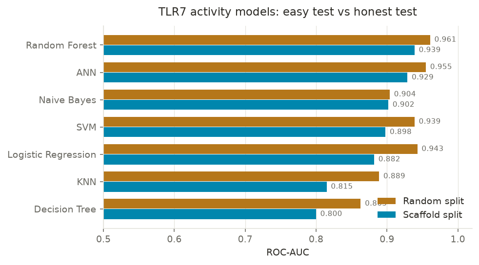
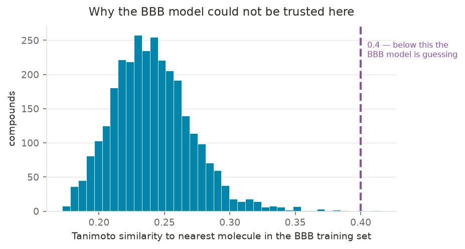
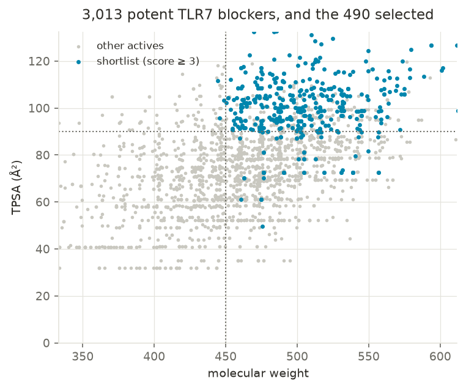

# Predicting TLR7 inhibitors that stay out of the brain

A machine-learning screen of public TLR7 bioactivity data, built to answer a
drug-design question rather than a benchmark question: **which potent TLR7
blockers look like they will act in the body but not reach the central nervous
system?**

TLR7 antagonists are of interest for peripheral autoimmune disease such as
lupus, where activity in the brain is an unwanted side effect rather than the
goal.

---

## Headline results

| | |
|---|---|
| Molecules modelled | 4,039 unique compounds with TLR7 IC50 data |
| Best activity model | Random Forest, **ROC-AUC 0.939** on a scaffold split |
| Models compared | 7 (Naive Bayes, KNN, Decision Tree, Random Forest, SVM, Logistic Regression, ANN) |
| BBB model | Random Forest, ROC-AUC 0.827 — **but shown to be out of its applicability domain for these compounds** |
| Final shortlist | **490 potent TLR7 blockers** selected on transparent physicochemical rules |

The most useful finding in this project is a negative one: the blood-brain
barrier model, which performs respectably on its own test set, turned out to
have no business making predictions about this chemical series. Section
["When the model should not be trusted"](#when-the-model-should-not-be-trusted)
explains how that was detected and what was done instead.

---

## Data

**Activity data — ChEMBL.** Target `CHEMBL5936` (human Toll-like receptor 7),
9,107 activity records carrying a pChEMBL value.

Two cleaning decisions matter:

1. **IC50 only.** The raw data mixes IC50 (inhibition) and EC50 (activation).
   These mean opposite things, so pooling them makes the label meaningless.
   Keeping IC50 (7,459 records) defines the task as *predicting TLR7
   antagonists*.
2. **One row per molecule.** Compounds measured in several papers were
   collapsed to the median pChEMBL value, giving **4,039 unique molecules**.

**Label.** Active = pChEMBL >= 7 (IC50 <= 100 nM), a standard potency cut in
medicinal chemistry. This gives 3,013 active / 1,026 inactive (74.6% active).
The imbalance is deliberate and kept: it is why accuracy alone is reported
alongside a baseline throughout.

**BBB data — B3DB.** 7,805 molecules labelled BBB+ / BBB− (4,956 / 2,849).

---

## Methods

### Features

| Task | Representation | Why |
|---|---|---|
| TLR7 activity | Morgan fingerprints (ECFP4, 2048 bits) | activity depends on specific substructures |
| Brain penetration | 12 physicochemical descriptors + ECFP4 (1024 bits) | crossing depends on bulk properties — size, lipophilicity, polar surface, H-bonding |

### Validation

Every model is evaluated on **both** a random split and a **scaffold split**
(Murcko scaffolds; no core structure appears in both train and test).

A random split lets close analogues sit on both sides, so the model is
effectively tested on molecules it has already seen variants of. The scaffold
split forces generalisation to new chemistry and is the number worth quoting.

Hyperparameters were selected by 5-fold cross-validation **on the training set
only**, scored on ROC-AUC; the test set was touched once, at the end.

---

## Results

### Seven classifiers, two splits



ROC-AUC, 80/20 split, default hyperparameters:

| Model | Random split | Scaffold split |
|---|---|---|
| **Random Forest** | 0.961 | **0.939** |
| ANN (MLP) | 0.955 | 0.929 |
| Naive Bayes | 0.904 | 0.902 |
| SVM (RBF) | 0.939 | 0.898 |
| Logistic Regression | 0.943 | 0.882 |
| Decision Tree | 0.863 | 0.800 |
| KNN | 0.889 | 0.815 |

Three things worth reading out of this table:

**ROC-AUC is the only fair comparison between the two splits.** The scaffold
split happens to produce test and training halves with different class balances
(78.6% vs 58.8% active), because large optimised scaffold series concentrate in
the training set. Accuracy and precision are not comparable across the two;
AUC is insensitive to class balance and is.

**KNN degrades most** (0.889 -> 0.815). It classifies by copying its nearest
neighbours, so when the test set contains genuinely novel cores there is
nothing useful to copy.

**Naive Bayes degrades least** (0.904 -> 0.902) despite being the weakest model
overall. It learns broad fragment trends rather than individual molecules, so
it has less to lose.

### Tuning helps weak models, not strong ones

| | before | after |
|---|---|---|
| **Decision Tree** train accuracy | 0.998 | 0.907 |
| **Decision Tree** test ROC-AUC | 0.800 | **0.890** |
| **Random Forest** test ROC-AUC | 0.939 | 0.939 |

`min_samples_leaf=10` stopped the Decision Tree branching down to single
molecules — textbook overfitting, visibly corrected. Grid search on the Random
Forest returned the library defaults; ensembling already does the work that
tuning does elsewhere.

### Brain-penetration model

Random Forest on B3DB, scaffold split:

| Features | ROC-AUC |
|---|---|
| 12 descriptors | 0.794 |
| 12 descriptors + ECFP4 (1024) | **0.827** |

Per-class performance at the default 0.5 threshold:

| | precision | recall |
|---|---|---|
| BBB− (stays out) | 0.79 | 0.44 |
| BBB+ (enters) | 0.67 | 0.91 |

Low BBB− recall is acceptable for screening — the aim is a trustworthy
shortlist, not a complete one. Tightening the threshold trades quantity for
confidence:

| Threshold | compounds called BBB− | precision |
|---|---|---|
| 0.50 | 383 | 0.794 |
| 0.35 | 192 | 0.875 |
| 0.25 | 114 | 0.921 |
| 0.20 | 81 | 0.963 |

---

## When the model should not be trusted

Applying the BBB model to the 3,013 TLR7 actives returned **zero** compounds
below the 0.25 threshold. The predicted probabilities told the real story:

```
mean 0.608   std 0.085   min 0.356   max 0.875
```

Everything bunched within a narrow band around 0.6 — which is almost exactly
the BBB+ base rate of the training set (63.5%). A Random Forest whose trees
disagree returns the class prior. The model was not predicting; it was
abstaining.

A nearest-neighbour similarity check confirmed why:



| Tanimoto similarity to nearest B3DB molecule | |
|---|---|
| median | 0.239 |
| maximum across all 3,013 compounds | 0.415 |
| share below 0.4 | **99.9%** |

Not one compound in the series has a close relative in the BBB training data.
TLR7 antagonists are large, rigid, highly aromatic molecules (median MW 474,
LogP 4.9, 4 aromatic rings) against a B3DB median of MW 363, LogP 2.5, 1
aromatic ring.

Taking those 0.6 probabilities at face value would have produced a confident,
meaningless ranking.

### What was done instead

Transparent physicochemical rules, each one a property known to oppose passive
CNS penetration. Every compound scores 0–4:

| Rule | compounds satisfying |
|---|---|
| TPSA > 90 Ų | 721 |
| MolWt > 450 | 2,067 |
| HBD >= 2 | 1,370 |
| Rotatable bonds >= 8 | 247 |

| Score | 0 | 1 | 2 | 3 | 4 |
|---|---|---|---|---|---|
| compounds | 388 | 1,408 | 727 | 417 | 73 |

For this series, **molecular size rather than polarity is the main property
working against brain penetration** — these are large but relatively non-polar
molecules.

### Final shortlist



**490 compounds** with a score of 3 or 4, ranked by potency; 73 satisfy all
four rules. Full table in `data/shortlist_peripheral.csv`.

Top entries:

| ChEMBL ID | pChEMBL | score | TPSA | MolWt | HBD | RotB |
|---|---|---|---|---|---|---|
| CHEMBL5837680 | 9.70 | 4 | 121.4 | 515.7 | 3 | 8 |
| CHEMBL5991391 | 9.52 | 4 | 96.8 | 530.7 | 2 | 8 |
| CHEMBL5836817 | 9.40 | 4 | 96.8 | 504.6 | 2 | 9 |
| CHEMBL5809111 | 9.10 | 4 | 105.9 | 574.8 | 2 | 9 |
| CHEMBL5966566 | 9.10 | 4 | 96.8 | 544.7 | 2 | 9 |

---

## Limitations

- **Passive diffusion only.** P-glycoprotein actively pumps drugs out of the
  brain and is a major determinant of CNS exposure. It is not modelled here.
  A compound can satisfy all four rules and still behave unexpectedly.
- **Rule thresholds are heuristics** drawn from the CNS drug-design literature
  (see CNS MPO, Wager et al.), not fitted to this series.
- **Cross-validation within the training set still shares scaffolds between
  folds**, so the tuning CV scores (RF: 0.959) are optimistic relative to the
  held-out scaffold test (0.939). A scaffold-grouped CV would be stricter.
- **ChEMBL is publication-biased** toward compounds that worked, which is why
  89% of the data sits above pChEMBL 6.
- **Activity labels are assay-heterogeneous**: IC50 values are pooled across
  different assays and laboratories.

## Possible extensions

- A P-glycoprotein substrate model to complement the passive rules
- Scaffold-grouped cross-validation for hyperparameter selection
- Tanimoto-metric KNN rather than Euclidean on scaled fingerprints
- The same pipeline applied to TLR8 (7,632 records) and TLR9 (6,831); TLR2 has
  only 334 and is too sparse to model honestly

---

## Repository

```
├── 01_get_data.ipynb            ChEMBL download, cleaning, fingerprints
├── 02_models.ipynb              7 classifiers, both splits, tuning
├── 03_bbb_and_figures.ipynb     B3DB model, applicability domain, screen, figures
├── data/                        generated files (not committed)
├── figures/
├── models/
├── requirements.txt
└── README.md
```

## Reproducing

```bash
python -m venv venv
venv\Scripts\activate          # Windows
pip install -r requirements.txt
jupyter notebook
```

Run the notebooks in order. `01` downloads from ChEMBL and takes a few minutes.

## Sources

- **ChEMBL** — Mendez et al., *Nucleic Acids Research* (2019). Target CHEMBL5936.
- **B3DB** — Meng et al., *Scientific Data* (2021). Blood-brain barrier dataset.
- **RDKit** — open-source cheminformatics toolkit.
- **scikit-learn** — Pedregosa et al., *JMLR* (2011).
